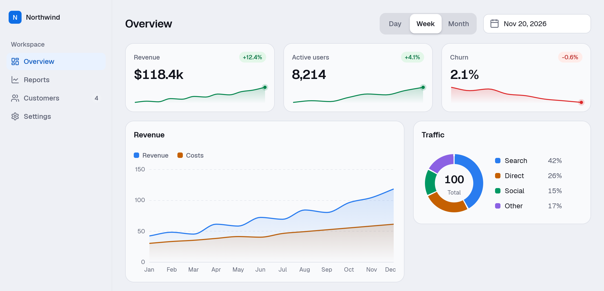
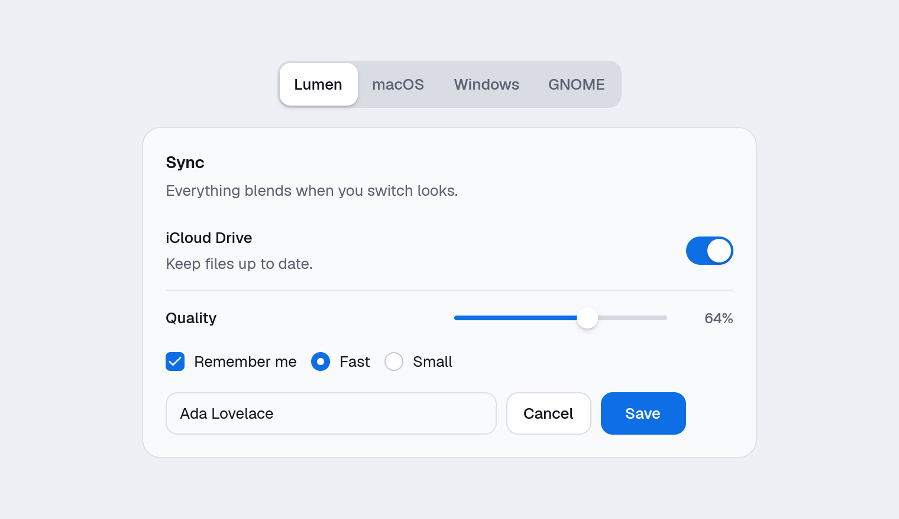
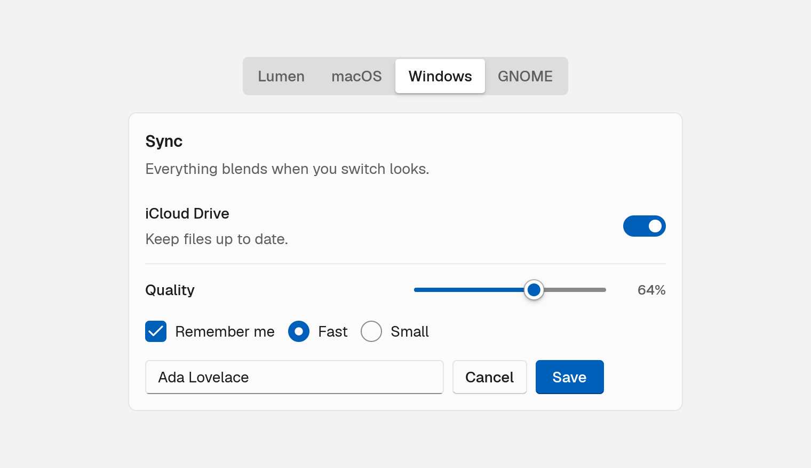
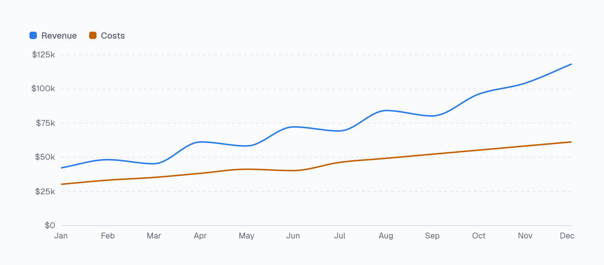

<p align="center">
  <picture>
    <source media="(prefers-color-scheme: dark)" srcset="site/assets/logo-mark-dark.svg">
    
  </picture>
</p>

<h1 align="center">lumen</h1>

<p align="center"><b>Rust interfaces that look finished.</b><br>An immediate-mode UI kit that draws its own components, natively and on the web.</p>

<p align="center">
  <a href="https://github.com/amiralibg/lumen/actions/workflows/ci.yml"></a>
  <a href="#license"></a>
  
</p>

<p align="center">
  <a href="https://amiralibg.github.io/lumen/">Live site</a> ·
  <a href="https://amiralibg.github.io/lumen/#/guide/getting-started">Getting started</a> ·
  <a href="https://amiralibg.github.io/lumen/#/components">Components</a> ·
  <a href="https://amiralibg.github.io/lumen/#/guide/looks">Looks</a> ·
  <a href="https://amiralibg.github.io/lumen/#/showcase">Showcase</a>
</p>

<picture>
  <source media="(prefers-color-scheme: dark)" srcset="site/img/hero-dark.png">
  
</picture>

<p align="center"><sub>Every image on this page was drawn by lumen, headless, from the demos in this repository.</sub></p>

lumen is a UI toolkit for Rust in the immediate-mode style of egui, built for finish: real typography, spring motion everywhere, OKLab-blended themes, and charts, date pickers and overlays that feel considered. It can look like itself, or like macOS, Windows 11 or GNOME.

- **170 components**, each with a live page on the [site](https://amiralibg.github.io/lumen/#/components).
- **Four looks.** Switching blends colors, corner radii, control sizes and motion together. `App::native()` follows the OS look, accent color, fonts and dark mode.
- **One codebase, native and web.** winit + wgpu on macOS, Windows and Linux; WebAssembly with WebGPU or WebGL2 in the browser.
- **Idle means idle.** A UI at rest requests no frames.

## Try it first

- **In the browser:** every component page on the [site](https://amiralibg.github.io/lumen/#/components) runs the real Rust code as WebAssembly.
- **On your machine:** `cargo run -p lumen-gallery` opens a complete settings app. `cargo run -p lumen-demos -- --list` lists one demo per component.
- **As a tutorial:** [build a small expense tracker](https://amiralibg.github.io/lumen/#/guide/tutorial) with a form, a chart and a toast.

## A small program

```rust
#[derive(Default)]
struct State { notify: bool, volume: f32 }

fn main() {
    lumen::App::new("Settings").size(900, 600).run(State::default(), |ui, s| {
        ui.column().pad(24).gap(14).show(|ui| {
            ui.heading("General");
            ui.switch("Notifications", &mut s.notify);
            ui.slider("Volume", &mut s.volume, 0.0..=1.0);
            if ui.button("Save").primary().clicked() {
                println!("saved");
            }
        });
    });
}
```

**Your state is a plain struct.** lumen calls your view every frame with `&mut` access to it. There are no messages, signals or retained widget objects.

**Widgets are builders.** Every option has a sensible default. Chained methods change it, and the widget is added when the builder is dropped or when you call `.clicked()`, `.changed()` or `.show()`.

**You never write animation code.** Toggles, presses, focus rings, sliding indicators and chart values are springs solved in closed form, so they're exact at any frame rate and keep their velocity when interrupted.

## What it is, and what it isn't

| | How it draws | Where lumen differs |
|---|---|---|
| egui | Immediate mode, own widgets | Same model. lumen spends its effort on finish: OKLab theming, springs, real type, platform looks. |
| GPUI | Retained elements, own renderer | Zed's framework, desktop only. lumen is immediate mode and also runs in the browser. The two don't combine. |
| iced, Slint | Elm-style messages, or a markup language | lumen is plain Rust functions over your state. |
| Tauri, Electron | A web view | lumen is one native binary drawing with the GPU, with no browser engine. |
| AppKit, WinUI, GTK | The OS's own widgets | lumen doesn't wrap them. Its platform looks follow their conventions, but they're lumen widgets. |

## Install

lumen isn't on crates.io yet. Depend on the repository:

```toml
[dependencies]
lumen = { git = "https://github.com/amiralibg/lumen" }
```

To build for the web:

```sh
rustup target add wasm32-unknown-unknown
cargo install wasm-bindgen-cli --version 0.2.130   # must match Cargo.toml
./scripts/build-web.sh                             # the gallery, into web/dist
./scripts/build-site.sh                            # this site with live demos, into site/
```

## What's in it

| Group | Components |
|---|---|
| Actions | button, icon button |
| Inputs | text input, select, slider |
| Selection | switch, checkbox, radio, segmented control |
| Navigation | tabs, sidebar with sections and badges |
| Overlays | menu, popover, dialog, tooltip |
| Feedback | toast, badge, status, progress, spinner |
| Dates | calendar, range calendar, date picker, date range picker |
| Charts | line, area, bar, stacked bar, donut, gauge, sparkline, stat tile |
| Layout and surfaces | row, column, stack, scroll, card, settings rows, accent picker |
| Your own | `ui.interact`, per-widget memory, springs, layers, and a painter with rounded rects, shadows, text, icons, polylines, fills and arcs |

Every component reads its geometry from the current look and its colors from named tokens, so it follows theme, accent and look changes, animated.

## Looks

| Lumen | macOS |
|---|---|
|  |  |
| **Windows 11** | **GNOME** |
|  |  |

```rust
lumen::App::new("Settings").native();               // OS look, accent, fonts and dark mode

ui.set_look(Look::mac().rounded(1.2).density(Density::Compact).motion(Motion::playful()));
ui.set_accent(Accent::from_hue(160.0));             // any hue; shades are derived for contrast
ui.override_color(Mode::Dark, Token::Background, Some(Color::hex(0x101418)));
```

## Charts and dates

<picture>
  <source media="(prefers-color-scheme: dark)" srcset="site/img/chart-line-dark.png">
  
</picture>

Charts pick round-number axes, thin out labels to fit, spring to new data, and show a crosshair with a tooltip on hover. Calendars slide between months, walk with the arrow keys, and join ranges across weeks.

## Platforms

| Platform | Window and input | Renderer |
|---|---|---|
| macOS | winit | wgpu (Metal) |
| Windows | winit | wgpu (DirectX 12, Vulkan) |
| Linux (X11, Wayland) | winit | wgpu (Vulkan, OpenGL) |
| Browsers | winit (web) | WebGPU, or WebGL2 |

## Limitations

- **Early.** The API will change. There's no crates.io release yet.
- **No screen reader support yet.** Everything is keyboard reachable with visible focus; AccessKit is planned.
- **Platform looks are lumen widgets.** They follow each OS's conventions closely but aren't the OS's own controls.
- **No combobox, data table, tree, code editor or docking yet.** They're next.
- **OS accent and reduce-motion detection** is tested on macOS and the web. Windows and GNOME use registry and `gsettings` queries that haven't run on real machines yet.

## Architecture

```
lumen-text    cosmic-text shaping, bundled fonts, glyph atlas
lumen-core    ids, input, layout, looks, springs, widgets → DrawData
lumen-wgpu    one pipeline, one WGSL shader
lumen-app     winit event loop (native + wasm), clipboard, OS preferences, screenshots
lumen         facade
```

`lumen-core` never touches a window or a GPU. Each 64-byte vertex carries its own shape data (SDF rounded rect, blurred shadow, glyph or plain mesh), so a renderer backend is one shader.

## How it's built and tested

Most of lumen's code was written with Claude under the maintainer's direction; commits record that in a `Co-Authored-By` trailer. The core is tested headlessly: springs, OKLab color, contrast of every derived accent in every look, layout, dates, chart math and widget interaction run under `cargo test`, and every screenshot in this README is regenerated by `./scripts/screenshots.sh`.

```sh
cargo test --workspace
```

## Documentation

| Guide | What it covers |
|---|---|
| [Getting started](https://amiralibg.github.io/lumen/#/guide/getting-started) | Install, hello world, web builds |
| [Tutorial](https://amiralibg.github.io/lumen/#/guide/tutorial) | A small app with a form, a chart and a toast |
| [Layout](https://amiralibg.github.io/lumen/#/guide/layout) | Rows, columns, sizing, scroll |
| [Looks and theming](https://amiralibg.github.io/lumen/#/guide/looks) | Looks, accents, tokens, following the OS |
| [Motion](https://amiralibg.github.io/lumen/#/guide/motion) | Springs, fades, motion presets, reduced motion |
| [Custom widgets](https://amiralibg.github.io/lumen/#/guide/custom-widgets) | Interaction, memory, painting, layers |
| [FAQ](https://amiralibg.github.io/lumen/#/guide/faq) | Native UI, GPUI, platforms, roadmap |
| [DESIGN.md](DESIGN.md) | Every token, spring and look parameter |

## What's next

Combobox, command palette, number and tag inputs; a table and a virtualized data grid; tree; code editor; docking panels; AccessKit. Then **Vault**, a password manager built with lumen.

## License

MIT or Apache-2.0, at your option. Bundled fonts: Geist and Geist Mono (SIL OFL 1.1), Lucide icons (ISC). See [THIRD_PARTY.md](THIRD_PARTY.md).
