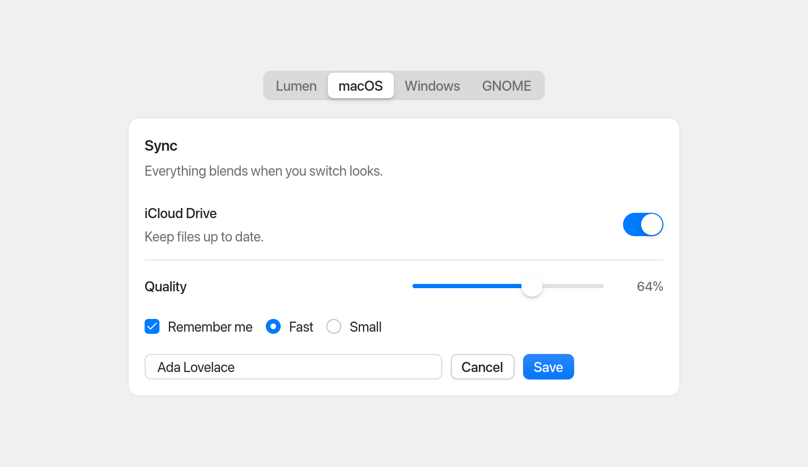
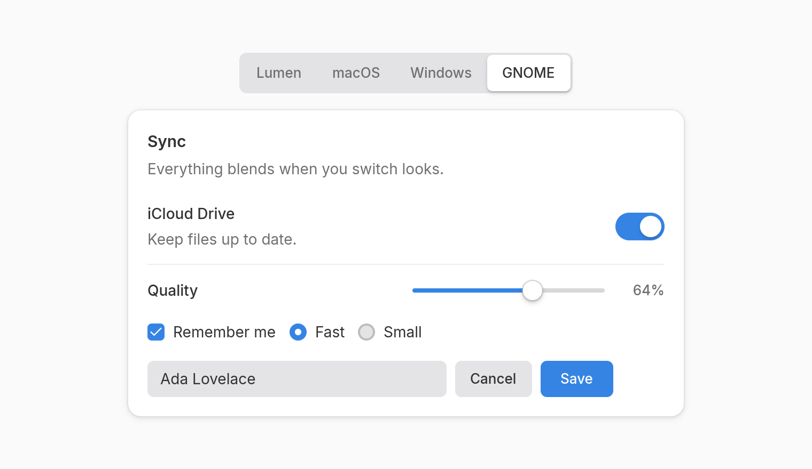

<p align="center">
  <picture>
    <source media="(prefers-color-scheme: dark)" srcset="site/assets/logo-mark-dark.svg">
    
  </picture>
</p>

<h1 align="center">lumen</h1>

<p align="center"><b>Rust interfaces that look finished.</b><br>An immediate-mode UI kit that draws its own components, natively and on the web.</p>

<p align="center">
  <a href="https://github.com/amiralibg/lumen/actions/workflows/ci.yml"></a>
  <a href="#license"></a>
  
</p>

<p align="center">
  <a href="https://amiralibg.github.io/lumen/">Live site</a> ·
  <a href="https://amiralibg.github.io/lumen/#/guide/getting-started">Getting started</a> ·
  <a href="https://amiralibg.github.io/lumen/#/components">Components</a> ·
  <a href="https://amiralibg.github.io/lumen/#/guide/looks">Looks</a> ·
  <a href="https://amiralibg.github.io/lumen/#/showcase">Showcase</a>
</p>

<picture>
  <source media="(prefers-color-scheme: dark)" srcset="site/img/hero-dark.png">
  
</picture>

lumen is a UI toolkit for Rust in the immediate-mode style of egui, built for finish. It has real typography, spring motion on every control, themes blended in OKLab, and charts, date pickers and overlays that feel considered. It can look like itself, or like macOS, Windows 11 or GNOME.

## Features

- **177 components** in 14 groups, from buttons to a Gantt chart, a code editor and an AI chat thread. Each one has a live page on the [site](https://amiralibg.github.io/lumen/#/components).
- **Eight complete apps**: mail, music, an issue tracker, notes, an AI assistant, finance, a to-do list and settings. Each runs live in the browser and reflows down to phone width.
- **Four looks.** Lumen, macOS, Windows 11 and GNOME. Switching blends colors, corner radii, control sizes and motion together. `App::native()` follows the OS look, accent color, fonts and dark mode.
- **Motion you don't write.** Toggles, presses, focus rings, sliding indicators and chart values are springs solved in closed form, so they're exact at any frame rate and keep their velocity when interrupted. Reduced motion is honored everywhere.
- **One codebase, native and web.** winit + wgpu on macOS, Windows and Linux. WebAssembly with WebGPU or WebGL2 in the browser.
- **Idle means idle.** A UI at rest requests no frames.
- **Plays well with GPUI.** [`lumen-gpui`](#gpui) puts lumen views inside a Zed-style GPUI app.

<picture>
  <source media="(prefers-color-scheme: dark)" srcset="site/img/chart-line-dark.png">
  
</picture>

| | How it draws | Where lumen differs |
|---|---|---|
| egui | Immediate mode, own widgets | Same model. lumen spends its effort on finish: OKLab theming, springs, real type, platform looks. |
| GPUI | Retained elements, own renderer | Zed's framework, desktop only. lumen is immediate mode and also runs in the browser, and can live inside a GPUI app. |
| iced, Slint | Elm-style messages, or a markup language | lumen is plain Rust functions over your state. |
| Tauri, Electron | A web view | lumen is one native binary drawing with the GPU, with no browser engine. |
| AppKit, WinUI, GTK | The OS's own widgets | lumen doesn't wrap them. Its platform looks follow their conventions, but they're lumen widgets. |

## Install

lumen isn't on crates.io yet. Depend on the repository:

```toml
[dependencies]
lumen = { git = "https://github.com/amiralibg/lumen" }
```

It needs Rust 1.89 or newer. On Linux, install the usual winit and Vulkan development packages (`libxkbcommon-dev`, `libwayland-dev`, `libx11-dev`, `libvulkan-dev`, or your distribution's equivalents).

To build for the web:

```sh
rustup target add wasm32-unknown-unknown
cargo install wasm-bindgen-cli --version 0.2.130   # must match Cargo.toml
./scripts/build-web.sh                             # the gallery, into web/dist
./scripts/build-site.sh                            # the site with live demos, into site/
```

## Quick start

```rust
#[derive(Default)]
struct State { notify: bool, volume: f32 }

fn main() {
    lumen::App::new("Settings").size(900, 600).run(State::default(), |ui, s| {
        ui.column().pad(24).gap(14).show(|ui| {
            ui.heading("General");
            ui.switch("Notifications", &mut s.notify);
            ui.slider("Volume", &mut s.volume, 0.0..=1.0);
            if ui.button("Save").primary().clicked() {
                println!("saved");
            }
        });
    });
}
```

- **Your state is a plain struct.** lumen calls your view every frame with `&mut` access to it. There are no messages, signals or retained widget objects.
- **Widgets are builders.** Every option has a sensible default. Chained methods change it, and the widget is added when the builder is dropped or when you call `.clicked()`, `.changed()` or `.show()`.
- **Layout is rows and columns.** Children hug, fill or take a fixed size, rows can wrap or scroll sideways, and text wraps to fit.

Run what's in the repository:

```sh
cargo run -p lumen-gallery                 # a complete settings app
cargo run -p lumen-demos -- --list         # one demo per component
cargo run -p lumen-demos -- app-mail       # a whole app
cargo run -p lumen-demos -- calendar --look mac --dark
```

The [guide](https://amiralibg.github.io/lumen/#/guide/getting-started) covers layout, looks, motion and custom widgets, and the [tutorial](https://amiralibg.github.io/lumen/#/guide/tutorial) builds a small expense tracker with a form, a chart and a toast.

## Components

177 components in 14 groups. Each name links to its live page.

| Group | Components |
|---|---|
| Actions (6) | [Button](https://amiralibg.github.io/lumen/#/components/button), [Split button](https://amiralibg.github.io/lumen/#/components/split-button), [Hold and copy buttons](https://amiralibg.github.io/lumen/#/components/hold-button), [Floating action bar](https://amiralibg.github.io/lumen/#/components/action-bar), [Speed dial](https://amiralibg.github.io/lumen/#/components/speed-dial), [Reaction bar](https://amiralibg.github.io/lumen/#/components/reaction-bar) |
| Inputs (24) | [Text input](https://amiralibg.github.io/lumen/#/components/text-input), [Text area](https://amiralibg.github.io/lumen/#/components/text-area), [Number field](https://amiralibg.github.io/lumen/#/components/number-field), [Tag input](https://amiralibg.github.io/lumen/#/components/tag-input), [One-time code](https://amiralibg.github.io/lumen/#/components/otp-input), [Password input](https://amiralibg.github.io/lumen/#/components/password-input), [Search field](https://amiralibg.github.io/lumen/#/components/search-field), [Select](https://amiralibg.github.io/lumen/#/components/select), [Combobox](https://amiralibg.github.io/lumen/#/components/combobox), [Multi-select](https://amiralibg.github.io/lumen/#/components/multi-select), [Color picker](https://amiralibg.github.io/lumen/#/components/color-picker), [Slider](https://amiralibg.github.io/lumen/#/components/slider), [Range slider](https://amiralibg.github.io/lumen/#/components/range-slider), [Shortcut recorder](https://amiralibg.github.io/lumen/#/components/shortcut-recorder), [Dropzone](https://amiralibg.github.io/lumen/#/components/dropzone), [Stepper](https://amiralibg.github.io/lumen/#/components/stepper), [Emoji picker](https://amiralibg.github.io/lumen/#/components/emoji-picker), [Editable text](https://amiralibg.github.io/lumen/#/components/editable-text), [Money field](https://amiralibg.github.io/lumen/#/components/money-field), [Masked input](https://amiralibg.github.io/lumen/#/components/masked-input), [Mention input](https://amiralibg.github.io/lumen/#/components/mention-input), [Numeric keypad](https://amiralibg.github.io/lumen/#/components/numeric-pad), [Dimension input](https://amiralibg.github.io/lumen/#/components/dimension-input), [Attachment list](https://amiralibg.github.io/lumen/#/components/attachment-list) |
| Selection (16) | [Switch](https://amiralibg.github.io/lumen/#/components/switch), [Checkbox](https://amiralibg.github.io/lumen/#/components/checkbox), [Radio](https://amiralibg.github.io/lumen/#/components/radio), [Radio cards](https://amiralibg.github.io/lumen/#/components/radio-cards), [Rating](https://amiralibg.github.io/lumen/#/components/rating), [Segmented control](https://amiralibg.github.io/lumen/#/components/segmented), [Filter chips](https://amiralibg.github.io/lumen/#/components/chips), [Toggle group](https://amiralibg.github.io/lumen/#/components/toggle-group), [Wheel and time picker](https://amiralibg.github.io/lumen/#/components/wheel-picker), [Step slider](https://amiralibg.github.io/lumen/#/components/step-slider), [Transfer list](https://amiralibg.github.io/lumen/#/components/transfer-list), [Rotary knob](https://amiralibg.github.io/lumen/#/components/rotary-knob), [Quantity picker](https://amiralibg.github.io/lumen/#/components/quantity-picker), [Swatch picker](https://amiralibg.github.io/lumen/#/components/swatch-picker), [View switcher](https://amiralibg.github.io/lumen/#/components/view-switcher), [Gradient slider](https://amiralibg.github.io/lumen/#/components/gradient-slider) |
| Navigation (13) | [Tabs](https://amiralibg.github.io/lumen/#/components/tabs), [Breadcrumb](https://amiralibg.github.io/lumen/#/components/breadcrumb), [Pagination](https://amiralibg.github.io/lumen/#/components/pagination), [Steps](https://amiralibg.github.io/lumen/#/components/steps), [Sidebar](https://amiralibg.github.io/lumen/#/components/sidebar), [Toolbar](https://amiralibg.github.io/lumen/#/components/toolbar), [Status bar](https://amiralibg.github.io/lumen/#/components/status-bar), [Menu bar](https://amiralibg.github.io/lumen/#/components/menu-bar), [Editor tabs](https://amiralibg.github.io/lumen/#/components/editor-tabs), [Table of contents](https://amiralibg.github.io/lumen/#/components/table-of-contents), [Navigation bar](https://amiralibg.github.io/lumen/#/components/nav-bar), [Progress steps](https://amiralibg.github.io/lumen/#/components/progress-steps), [Shortcut bar](https://amiralibg.github.io/lumen/#/components/shortcut-bar) |
| Overlays (9) | [Menu](https://amiralibg.github.io/lumen/#/components/menu), [Popover](https://amiralibg.github.io/lumen/#/components/popover), [Dialog](https://amiralibg.github.io/lumen/#/components/dialog), [Sheet](https://amiralibg.github.io/lumen/#/components/sheet), [Command palette](https://amiralibg.github.io/lumen/#/components/command-palette), [Hover card](https://amiralibg.github.io/lumen/#/components/hover-card), [Context menu](https://amiralibg.github.io/lumen/#/components/context-menu), [Confirm popover](https://amiralibg.github.io/lumen/#/components/confirm-popover), [Guided tour](https://amiralibg.github.io/lumen/#/components/tour) |
| Feedback (16) | [Toast](https://amiralibg.github.io/lumen/#/components/toast), [Tooltip](https://amiralibg.github.io/lumen/#/components/tooltip), [Badge and status](https://amiralibg.github.io/lumen/#/components/badge), [Progress and spinner](https://amiralibg.github.io/lumen/#/components/progress), [Segmented meter](https://amiralibg.github.io/lumen/#/components/meter), [Alert and banner](https://amiralibg.github.io/lumen/#/components/alert), [Skeleton](https://amiralibg.github.io/lumen/#/components/skeleton), [Empty state](https://amiralibg.github.io/lumen/#/components/empty-state), [Notification inbox](https://amiralibg.github.io/lumen/#/components/notification-list), [Callout](https://amiralibg.github.io/lumen/#/components/callout), [Undo snackbar](https://amiralibg.github.io/lumen/#/components/undo-toast), [Countdown timer](https://amiralibg.github.io/lumen/#/components/countdown), [Stacked meter](https://amiralibg.github.io/lumen/#/components/stacked-meter), [Announcement bar](https://amiralibg.github.io/lumen/#/components/announcement-bar), [Presence pile](https://amiralibg.github.io/lumen/#/components/presence-pile), [Comment thread](https://amiralibg.github.io/lumen/#/components/comment-thread) |
| Data (17) | [Accordion](https://amiralibg.github.io/lumen/#/components/accordion), [Data table](https://amiralibg.github.io/lumen/#/components/table), [Tree view](https://amiralibg.github.io/lumen/#/components/tree), [Timeline](https://amiralibg.github.io/lumen/#/components/timeline), [Code block](https://amiralibg.github.io/lumen/#/components/code-block), [JSON viewer](https://amiralibg.github.io/lumen/#/components/json-viewer), [Key–value editor](https://amiralibg.github.io/lumen/#/components/key-value), [Log viewer](https://amiralibg.github.io/lumen/#/components/log-viewer), [Markdown view](https://amiralibg.github.io/lumen/#/components/markdown), [List view](https://amiralibg.github.io/lumen/#/components/list-view), [File browser and path bar](https://amiralibg.github.io/lumen/#/components/file-browser), [Reorderable list](https://amiralibg.github.io/lumen/#/components/reorderable-list), [Data grid](https://amiralibg.github.io/lumen/#/components/data-grid), [Filter bar](https://amiralibg.github.io/lumen/#/components/filter-bar), [Permission matrix](https://amiralibg.github.io/lumen/#/components/permission-matrix), [Description list](https://amiralibg.github.io/lumen/#/components/description-list), [A/B comparison](https://amiralibg.github.io/lumen/#/components/ab-comparison) |
| Planning (5) | [Kanban board](https://amiralibg.github.io/lumen/#/components/kanban), [Gantt chart](https://amiralibg.github.io/lumen/#/components/gantt), [Week schedule](https://amiralibg.github.io/lumen/#/components/day-schedule), [Node editor](https://amiralibg.github.io/lumen/#/components/node-editor), [Checklist card](https://amiralibg.github.io/lumen/#/components/checklist-card) |
| AI (8) | [AI reasoning and tools](https://amiralibg.github.io/lumen/#/components/ai-reasoning), [Prompt composer](https://amiralibg.github.io/lumen/#/components/ai-composer), [AI chat thread](https://amiralibg.github.io/lumen/#/components/ai-chat), [AI citations](https://amiralibg.github.io/lumen/#/components/ai-citations), [AI model picker](https://amiralibg.github.io/lumen/#/components/ai-model-picker), [Context meter](https://amiralibg.github.io/lumen/#/components/context-meter), [AI code suggestion](https://amiralibg.github.io/lumen/#/components/ai-suggestion), [Prompt templates](https://amiralibg.github.io/lumen/#/components/prompt-templates) |
| Developer tools (13) | [Diff viewer](https://amiralibg.github.io/lumen/#/components/diff-viewer), [Trace waterfall](https://amiralibg.github.io/lumen/#/components/waterfall), [Uptime status](https://amiralibg.github.io/lumen/#/components/uptime-bars), [Terminal](https://amiralibg.github.io/lumen/#/components/terminal), [Property inspector](https://amiralibg.github.io/lumen/#/components/property-grid), [Flame graph](https://amiralibg.github.io/lumen/#/components/flame-graph), [Code editor](https://amiralibg.github.io/lumen/#/components/code-editor), [Commit graph](https://amiralibg.github.io/lumen/#/components/commit-graph), [Test explorer](https://amiralibg.github.io/lumen/#/components/test-explorer), [API inspector](https://amiralibg.github.io/lumen/#/components/api-inspector), [Schema viewer](https://amiralibg.github.io/lumen/#/components/schema-viewer), [Environment switcher](https://amiralibg.github.io/lumen/#/components/env-switcher), [Memory profiler](https://amiralibg.github.io/lumen/#/components/memory-profiler) |
| Dates (8) | [Calendar](https://amiralibg.github.io/lumen/#/components/calendar), [Date picker](https://amiralibg.github.io/lumen/#/components/date-picker), [Date range picker](https://amiralibg.github.io/lumen/#/components/date-range-picker), [Time picker](https://amiralibg.github.io/lumen/#/components/time-picker), [Date strip](https://amiralibg.github.io/lumen/#/components/date-strip), [World clocks](https://amiralibg.github.io/lumen/#/components/world-clocks), [Schedule picker](https://amiralibg.github.io/lumen/#/components/schedule-picker), [Quarter picker](https://amiralibg.github.io/lumen/#/components/quarter-picker) |
| Charts (23) | [Line chart](https://amiralibg.github.io/lumen/#/components/line-chart), [Area chart](https://amiralibg.github.io/lumen/#/components/area-chart), [Bar chart](https://amiralibg.github.io/lumen/#/components/bar-chart), [Donut chart](https://amiralibg.github.io/lumen/#/components/donut), [Gauge](https://amiralibg.github.io/lumen/#/components/gauge), [Sparkline and stat](https://amiralibg.github.io/lumen/#/components/sparkline), [Progress and activity rings](https://amiralibg.github.io/lumen/#/components/progress-ring), [Bar list](https://amiralibg.github.io/lumen/#/components/bar-list), [Heatmap](https://amiralibg.github.io/lumen/#/components/heatmap), [Radar chart](https://amiralibg.github.io/lumen/#/components/radar-chart), [Scatter chart](https://amiralibg.github.io/lumen/#/components/scatter-chart), [Funnel chart](https://amiralibg.github.io/lumen/#/components/funnel-chart), [Candlestick chart](https://amiralibg.github.io/lumen/#/components/candlestick), [Treemap](https://amiralibg.github.io/lumen/#/components/treemap), [Calendar heatmap](https://amiralibg.github.io/lumen/#/components/calendar-heatmap), [Sankey chart](https://amiralibg.github.io/lumen/#/components/sankey-chart), [Contribution graph](https://amiralibg.github.io/lumen/#/components/contribution-graph), [Histogram](https://amiralibg.github.io/lumen/#/components/histogram), [KPI strip](https://amiralibg.github.io/lumen/#/components/kpi-strip), [Bullet chart](https://amiralibg.github.io/lumen/#/components/bullet-chart), [Metric watchlist](https://amiralibg.github.io/lumen/#/components/metric-table), [Win-loss chart](https://amiralibg.github.io/lumen/#/components/win-loss-chart), [Waffle chart](https://amiralibg.github.io/lumen/#/components/waffle-chart) |
| Motion (8) | [Rolling number](https://amiralibg.github.io/lumen/#/components/rolling-number), [Magnifying dock](https://amiralibg.github.io/lumen/#/components/dock), [Audio waveform](https://amiralibg.github.io/lumen/#/components/waveform), [Spotlight card](https://amiralibg.github.io/lumen/#/components/spotlight-card), [Text effects](https://amiralibg.github.io/lumen/#/components/text-effects), [Comparison slider](https://amiralibg.github.io/lumen/#/components/compare-slider), [Marquee ticker](https://amiralibg.github.io/lumen/#/components/marquee), [Graphic equalizer](https://amiralibg.github.io/lumen/#/components/equalizer) |
| Layout and surfaces (11) | [Keycap](https://amiralibg.github.io/lumen/#/components/kbd), [Card and settings rows](https://amiralibg.github.io/lumen/#/components/card), [Looks](https://amiralibg.github.io/lumen/#/components/looks), [Avatar](https://amiralibg.github.io/lumen/#/components/avatar), [Window chrome](https://amiralibg.github.io/lumen/#/components/window-chrome), [Split pane](https://amiralibg.github.io/lumen/#/components/split-pane), [Carousel](https://amiralibg.github.io/lumen/#/components/carousel), [Image frame](https://amiralibg.github.io/lumen/#/components/image-frame), [Masonry grid](https://amiralibg.github.io/lumen/#/components/masonry-grid), [Collapsible card](https://amiralibg.github.io/lumen/#/components/collapsible-card), [Pricing cards](https://amiralibg.github.io/lumen/#/components/pricing-cards) |

Plus building blocks for your own: `ui.interact`, per-widget memory, springs, layers, and a painter with rounded rects, shadows, text, icons, polylines, fills and arcs. Every component reads its geometry from the current look and its colors from named tokens, so it follows theme, accent and look changes, animated. The list is generated by `node scripts/component-index.mjs` from the same data as the site.

## Looks

| Lumen | macOS |
|---|---|
|  |  |
| **Windows 11** | **GNOME** |
|  |  |

```rust
lumen::App::new("Settings").native();               // OS look, accent, fonts and dark mode

ui.set_look(Look::mac().rounded(1.2).density(Density::Compact).motion(Motion::playful()));
ui.set_accent(Accent::from_hue(160.0));             // any hue; shades are derived for contrast
ui.override_color(Mode::Dark, Token::Background, Some(Color::hex(0x101418)));
```

A look bundles neutrals, control sizes, radii, per-widget shapes, fonts and motion. Eight named accents, or any custom one, are checked for contrast in every look and mode. [DESIGN.md](DESIGN.md) lists every token, spring and look parameter.

## Platforms

| Platform | Window and input | Renderer | Status |
|---|---|---|---|
| macOS | winit | wgpu (Metal) | Used daily. OS accent, reduce motion and live dark mode are read. |
| Windows | winit | wgpu (DirectX 12, Vulkan) | Not yet tested on a real machine. Accent and reduce motion come from registry queries. |
| Linux (X11, Wayland) | winit | wgpu (Vulkan, OpenGL) | Checked in CI on Ubuntu, not yet run on a real desktop. GNOME accent and reduce motion come from `gsettings`. |
| Browsers | winit (web) | WebGPU, or WebGL2 | Every page of the site. |

How it draws:

```
lumen-text    cosmic-text shaping, bundled fonts, glyph atlas
lumen-core    ids, input, layout, looks, springs, widgets → DrawData
lumen-wgpu    one pipeline, one WGSL shader
lumen-app     winit event loop (native + wasm), clipboard, OS preferences, screenshots
lumen         facade
lumen-gpui    optional: lumen views inside a GPUI app (its own workspace)
```

`lumen-core` never touches a window or a GPU. Each 64-byte vertex carries its own shape data (SDF rounded rect, blurred shadow, glyph or plain mesh), so a renderer backend is one shader.

Limits today:

- **Early.** The API will change, and there's no crates.io release yet.
- **No screen reader support yet.** Everything is keyboard reachable with visible focus. AccessKit is in progress.
- **Platform looks are lumen widgets.** They follow each OS's conventions closely but aren't the OS's own controls.

## GPUI

[`lumen-gpui`](crates/lumen-gpui) puts a lumen UI inside a [GPUI](https://gpui.rs) (Zed) app as an ordinary view. Build the app in GPUI and use lumen for panels, charts, forms and dialogs next to your GPUI elements. Mouse, scroll, keyboard, input methods (IME), clipboard, cursors and the window's dark mode are wired up, and lumen menus and popovers can overflow the view like native popups.

```rust
let panel = lumen_gpui::LumenView::build(Settings::default(), |ui, s| {
    ui.switch("Notifications", &mut s.notify);
    ui.slider("Volume", &mut s.volume, 0.0..=1.0);
}, window, cx);

div().size_full().child(panel.clone())                       // a GPUI element tree
panel.update(cx, |p, cx| p.update(cx, |s| s.volume = 0.2));  // GPUI → lumen state
```

GPUI can't host another renderer directly, so lumen renders offscreen and hands GPUI the pixels. Idle views cost nothing. While animating, a Retina-sized panel takes about 1.7 ms of main-thread time a frame with the pipelined readback. The [guide](https://amiralibg.github.io/lumen/#/guide/gpui) covers setup, state sharing and limits. Run `cargo run --example dashboard` in `crates/lumen-gpui` to see it.

## How it's built and tested

Most of lumen's code was written with Claude under the maintainer's direction, and commits record that in a `Co-Authored-By` trailer. The core is tested headlessly: springs, OKLab color, contrast of every derived accent in every look, layout, dates, chart math and widget interaction run under `cargo test --workspace`. Every image in this README is drawn by lumen and regenerated by `./scripts/screenshots.sh`, and `lumen-demos <demo> --screenshot out.png --check` reports clipped or overlapping text in any demo, look and size.

## License

MIT or Apache-2.0, at your option. Bundled fonts: Geist and Geist Mono (SIL OFL 1.1), Lucide icons (ISC). See [THIRD_PARTY.md](THIRD_PARTY.md).
